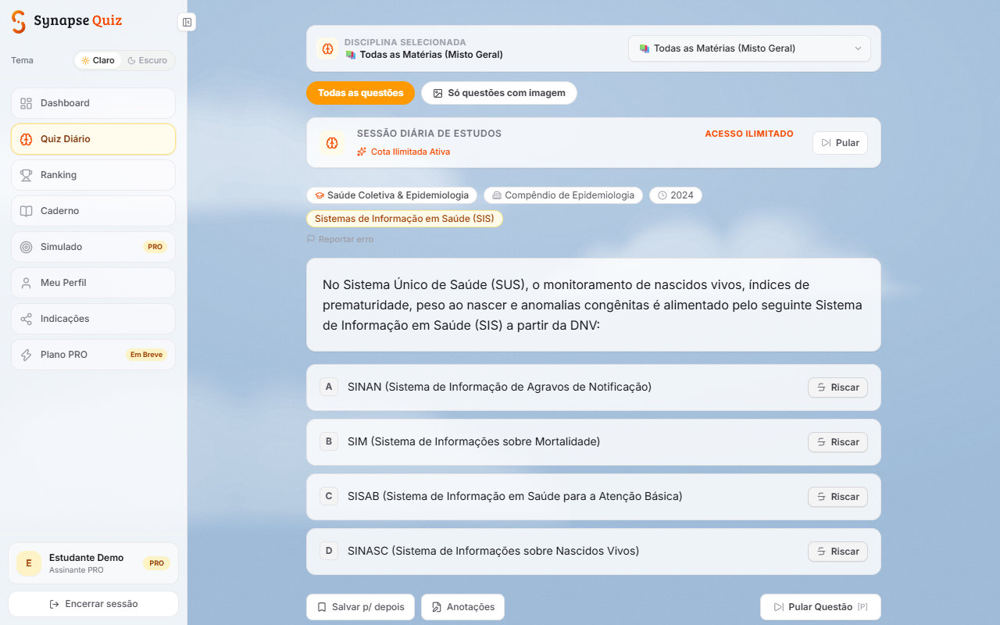
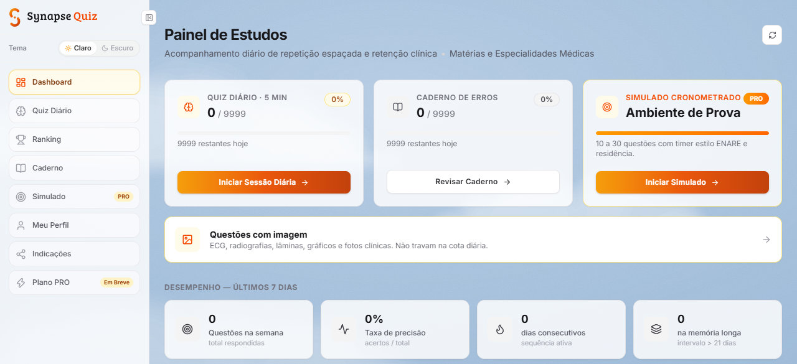
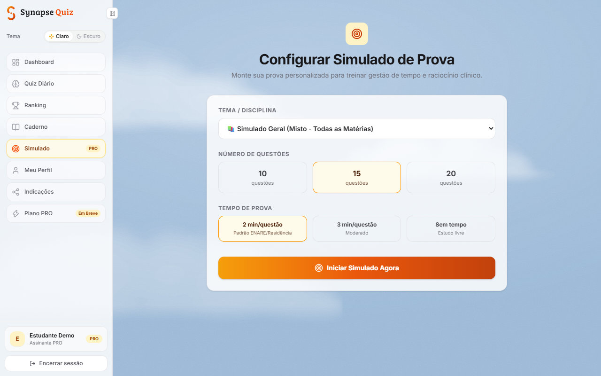
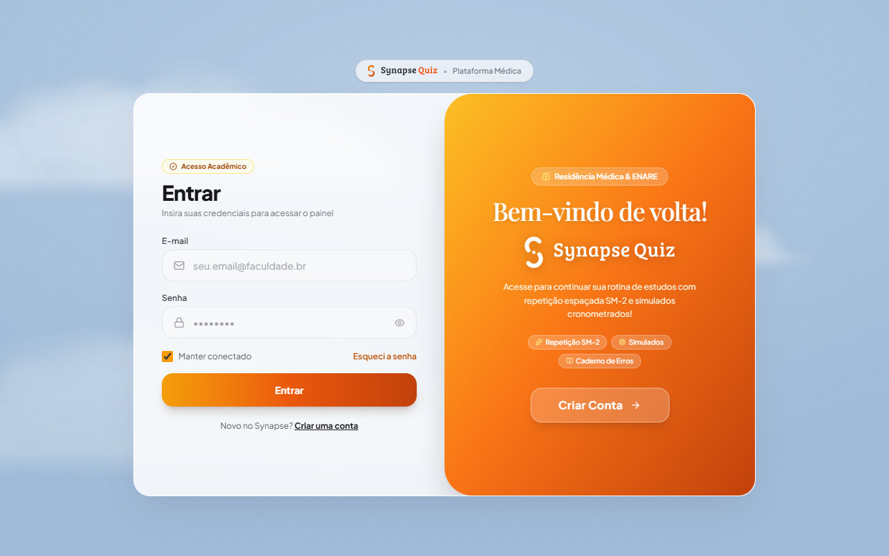
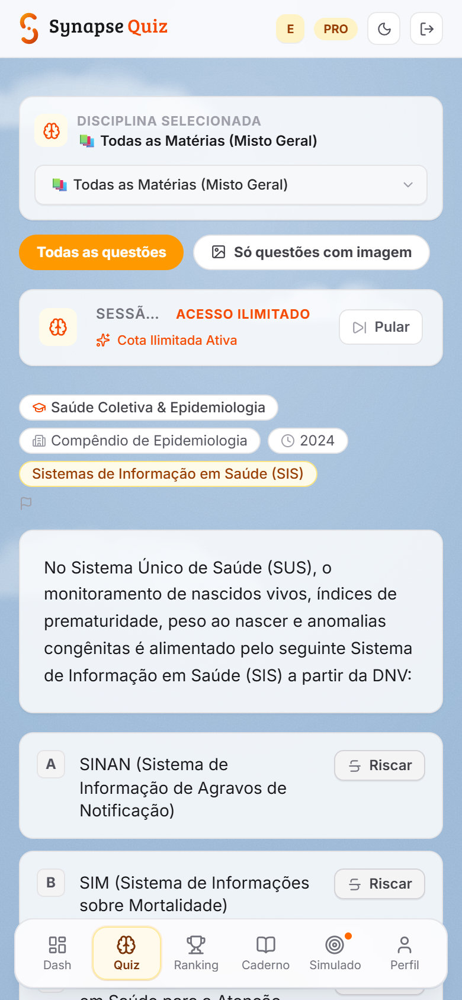

<h1 align="center">Synapse Quiz</h1>

  Plataforma de estudo para medicina com <strong>repetição espaçada</strong>, simulados cronometrados e ranking de estudantes.

  <a href="https://synapsequiz.vercel.app"><strong>Ver o app online</strong></a>

  
  
  
  
  
  

> Este repositório é só uma vitrine do projeto. O código-fonte é privado.

## O que é

O Synapse Quiz ajuda estudantes de medicina, do 1º período à preparação para a residência, a estudar com questões que voltam na hora certa. Cada resposta ajusta quando a questão aparece de novo, para fixar o conteúdo com menos esforço.

## Em números

- **Mais de 1.600 questões** com gabarito comentado, em **16 disciplinas** do ciclo básico ao clínico.
- **250 questões com imagem:** fotos clínicas, radiografias, lâminas, peças anatômicas, gráficos e obras de arte.
- **Toda questão nova cita a fonte** (livro-texto ou diretriz) que embasa a resposta e passou por revisão antes de entrar no app.

## Principais recursos

- **Repetição espaçada (SRS):** algoritmo baseado no SM-2. O acerto aumenta o intervalo de revisão e o erro faz a questão voltar no dia seguinte.
- **Quiz diário e por disciplina,** com casos clínicos e questões com imagem.
- **Simulados cronometrados** no estilo ENARE e residência, com histórico de tentativas e pontuação.
- **Ranking de estudantes:** pódio, pontos por acerto e constância, e filtros por faculdade e período.
- **Caderno de erros e favoritos**, **anotações por questão** e **riscar alternativas**.
- **Reportar erro de gabarito** em cada questão, com painel de administração para tratar os reportes.
- **Perfil do estudante** com crachá digital, faculdade e avatar.
- **Conta completa:** cadastro com verificação de e-mail, recuperação de senha e indicação de amigos.
- **PWA:** instalável no computador e no celular, com tema claro e escuro.

| Painel de estudos | Simulado |
|---|---|
|  |  |

| Login | No celular |
|---|---|
|  |  |

## Tecnologias

| Parte | Tecnologia |
|---|---|
| Framework | Next.js 16 (App Router) e React 19 |
| Estilo | Tailwind CSS 4, Radix UI e shadcn |
| Banco de dados | Prisma 6 com Turso (libSQL) |
| Autenticação | Cookie HTTP-only com JWT e senhas com hash |
| E-mail | Nodemailer |
| Deploy | Vercel |

## Sobre o conteúdo

As questões são elaboradas com IA e revisadas com base em livros-texto e diretrizes. Cada questão tem um botão para reportar erros. As imagens clínicas vêm de acervos de licença livre (Wikimedia Commons, CDC e outros), com os autores listados na página de créditos do app.

## Licença

© 2026 Lucas Fernandes Luz. Todos os direitos reservados. As imagens e os textos deste repositório não podem ser copiados nem reutilizados sem autorização. Veja [LICENSE](LICENSE).
